# Diagramas Mermaid — EitoDiceBanana CPU Simulator

**Fuente:** https://github.com/anaaacg/eitodicebanana_cpu_simulator_EC2 (rama main, consultada 2026-11-08)  
**Rúbrica:** Segundo parcial SIS-131, UCB, semestre 2/2026.

> Alcance: diagramas de arquitectura y flujos basados en la rúbrica, README y módulos presentes en el repositorio. Representan la arquitectura declarada y procesos esperados; no constituyen evidencia de que todas las rutas se hayan probado en tiempo de ejecución.

## 01. Arquitectura general del sistema

**Criterio:** G1–G5  
**Nota:** Visión de componentes documentados. Las flechas representan relaciones lógicas del simulador, no necesariamente cableado físico.

```mermaid
flowchart TB
    USER[Usuario] --> UI[Google Sheets: INICIO y paneles]
    UI --> CATALOG[CATALOGO_ASM]
    CATALOG --> EDIT[Editor ASM]
    EDIT --> ASM[Assembler.gs: dos pasadas]
    ASM --> LOAD[Cargador a memoria virtual]
    UI --> EXEC[Execution.gs: STEP / RUN / RESET]
    EXEC --> CPU[CPU.gs: registros y flags]
    CPU <--> ALU[ALU.gs]
    EXEC --> CU[ControlUnit.gs: microoperaciones]
    CU --> BUS[Buses.gs: triestado y señales]
    BUS <--> CACHE[Cache.gs: L1I / L1D / L2]
    CACHE <--> MMU[VirtualMemory.gs / Paging.gs]
    MMU <--> RAM[Memory.gs: RAM 256 B]
    MMU <--> SWAP[Swap emulado]
    BUS <--> KBD[Keyboard.gs: FIFO 8 B]
    BUS <--> LCD[LCD.gs: 8x1]
    EXEC --> TRACE[TRAZA y dashboard]
    CACHE --> TRACE
    MMU --> TRACE
```

## 02. CPU y buses con buffers triestado

**Criterio:** G1  
**Nota:** Modelo conceptual de los buses interno, de direcciones y de datos. Se exige un único emisor habilitado por bus durante cada microoperación.

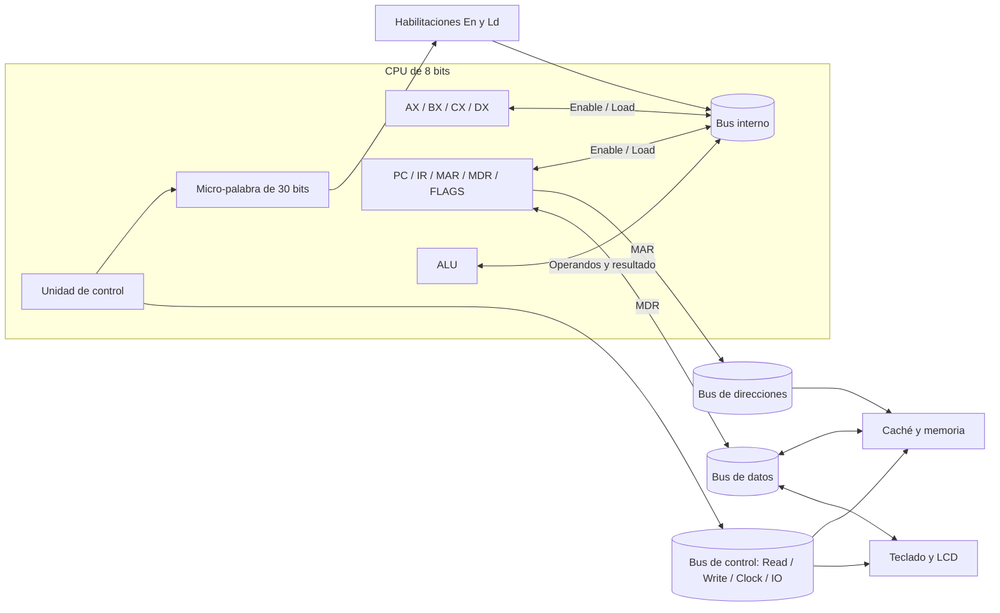

## 03. Arbitraje triestado y micro-palabra de control

**Criterio:** G1  
**Nota:** El controlador impide la contención entre transmisores. HIGH_Z es el estado de todos los emisores no seleccionados.

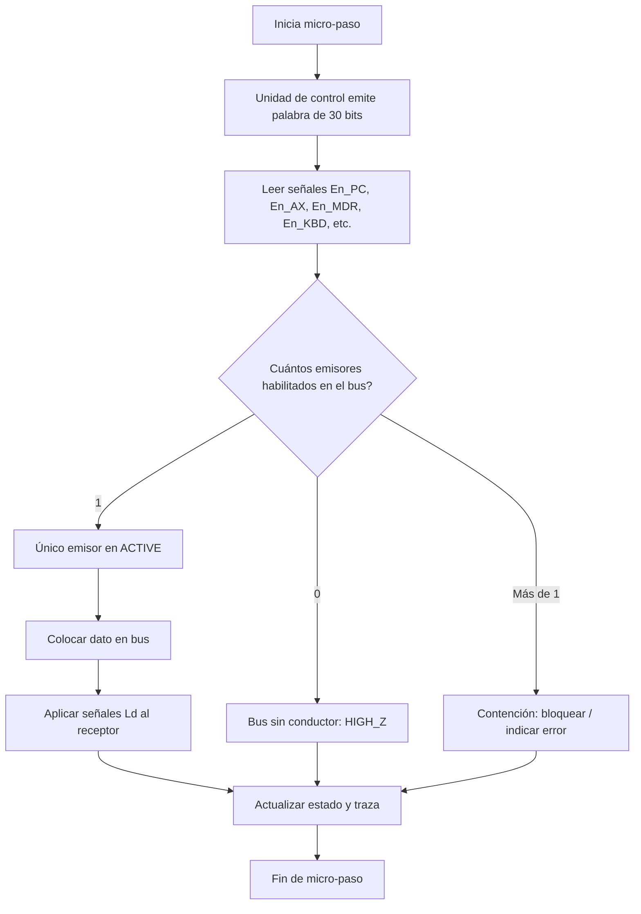

## 04. Ciclo de instrucción y microoperaciones

**Criterio:** G1, G5  
**Nota:** Secuencia funcional FETCH → DECODE → EXECUTE → STORE; un fallo de caché o página puede introducir micro-pasos adicionales.

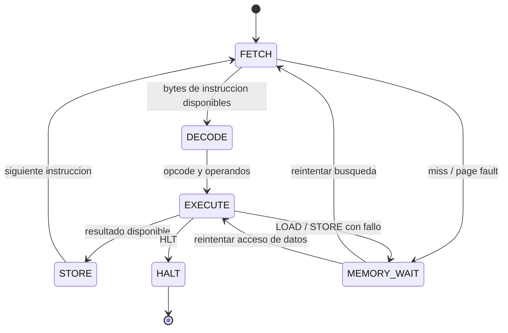

## 05. Jerarquía de caché L1I / L1D / L2

**Criterio:** G2  
**Nota:** Ruta conceptual de lectura y actualización de cachés. L1I y L1D almacenan una línea de 8 B; L2 contiene cuatro líneas de 8 B y utiliza FIFO.

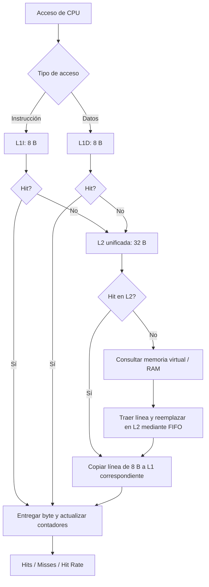

## 06. Traducción de direcciones virtuales

**Criterio:** G3  
**Nota:** 16 páginas virtuales de 32 B (512 B); 8 marcos físicos de 32 B (256 B). VPN = dirección virtual div 32; desplazamiento = dirección virtual mod 32.

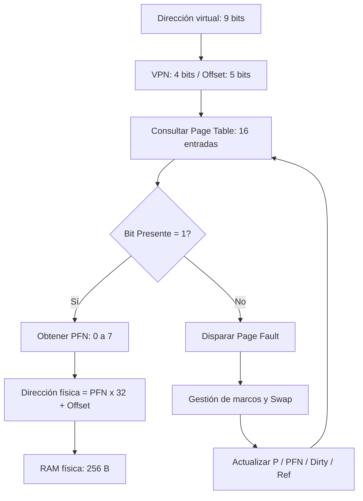

## 07. Gestión de Page Fault con reemplazo FIFO

**Criterio:** G3  
**Nota:** La documentación del proyecto señala que el marco 7 está fijado para MMIO; no debe seleccionarse como víctima FIFO.

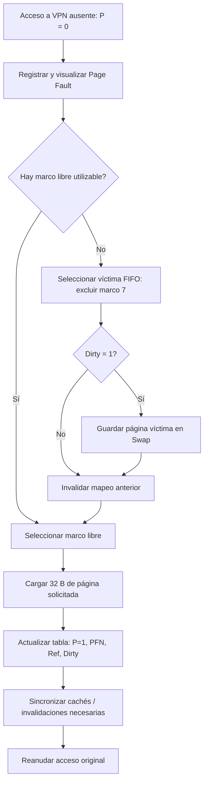

## 08. Entrada y salida: teclado y LCD

**Criterio:** G4  
**Nota:** El teclado tiene FIFO de 8 bytes y MMIO virtual 1F8h–1FFh; su almacenamiento físico es E8h–EFh. LCD usa F8h–FFh y un cursor circular.

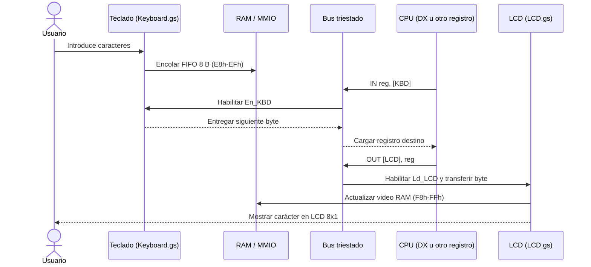

## 09. Editor, ensamblador y cargador de programas

**Criterio:** G5  
**Nota:** Refleja la documentación del catálogo persistente con cuatro programas de demostración y el ensamblador de dos pasadas.

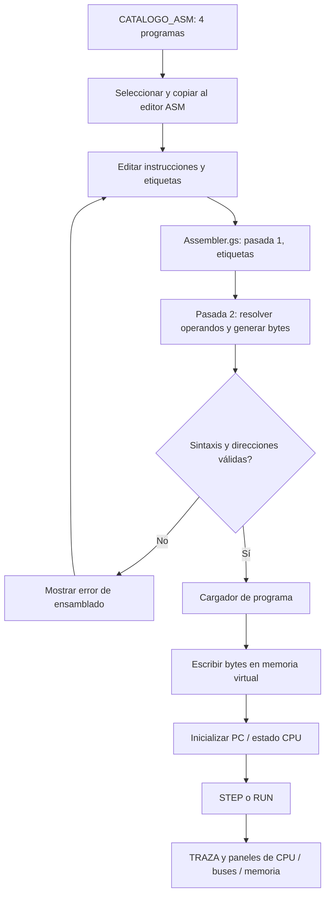

## 10. Organización de módulos del código fuente

**Criterio:** G6  
**Nota:** Mapa de archivos fuente visible en la rama main del repositorio; muestra dependencias conceptuales, no un grafo exacto de llamadas.

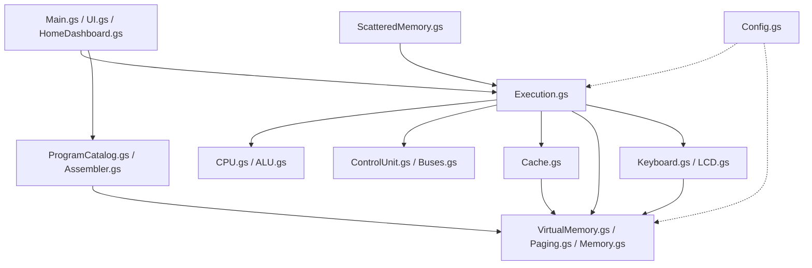

## 11. Procedimiento de demostración para la defensa

**Criterio:** G2–G5  
**Nota:** Propuesta de recorrido para mostrar los programas de catálogo, estados de la CPU, transferencia E/S y fallos de memoria.

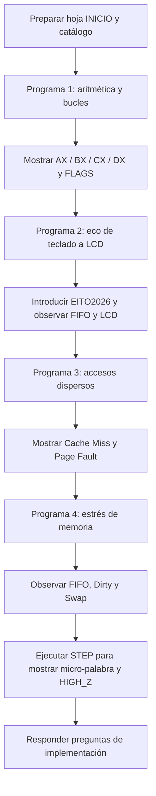

## Observaciones para la entrega

- Verificar en Google Sheets la ejecución real de los cuatro programas y el cambio dinámico de señales.
- Confirmar las políticas FIFO, write-through y write-allocate desde la versión desplegada.
- Mantener el mapeo MMIO físico y virtual alineado con el código actual.
- Incorporar los diagramas al README.md y README_EN.md con explicaciones bilingües.
