# Mermaid Diagrams — EitoDiceBanana CPU Simulator

**Source:** https://github.com/anaaacg/eitodicebanana_cpu_simulator_EC2 (main branch, accessed 2026-11-08)  
**Grading rubric:** SIS-131 Second Midterm, UCB, Semester 2/2026.

> Scope: Architecture and flow diagrams based on the grading rubric, README, and modules present in the repository. They depict the documented architecture and expected processes; they do not constitute evidence that every execution path has been tested at runtime.

## 01. Overall System Architecture

**Criterion:** G1–G5  
**Note:** Overview of documented components. Arrows indicate logical relationships within the simulator, not necessarily physical wiring.

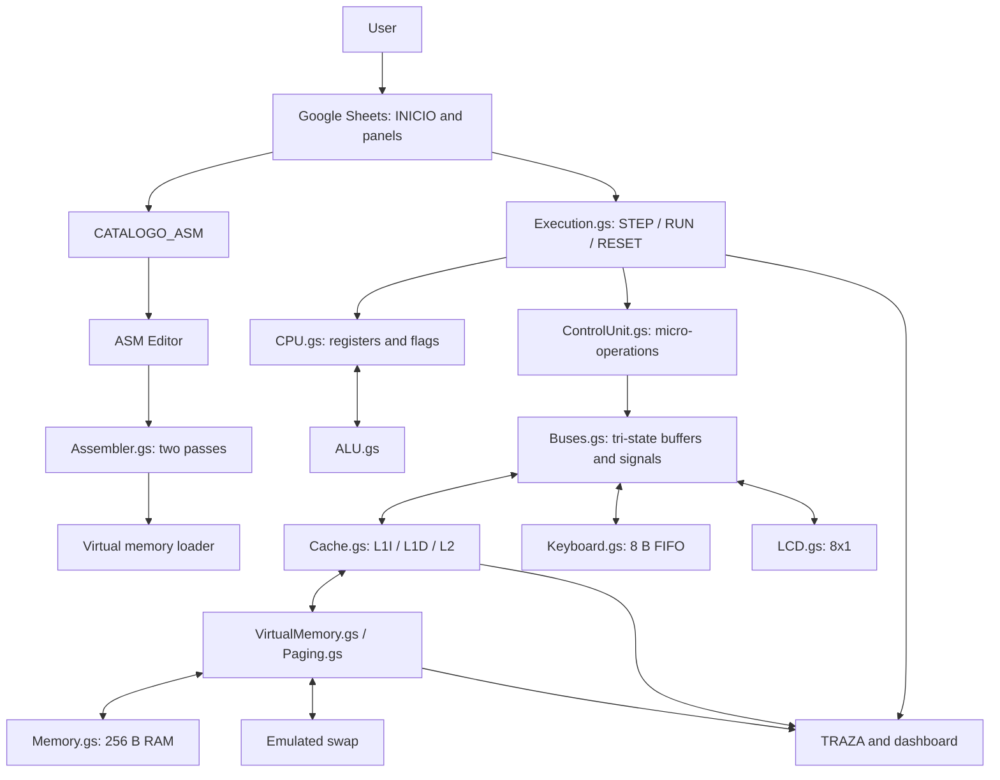

## 02. CPU and Buses with Tri-State Buffers

**Criterion:** G1  
**Note:** Conceptual model of the internal, address, and data buses. Only one transmitter may be enabled on each bus during any micro-operation.

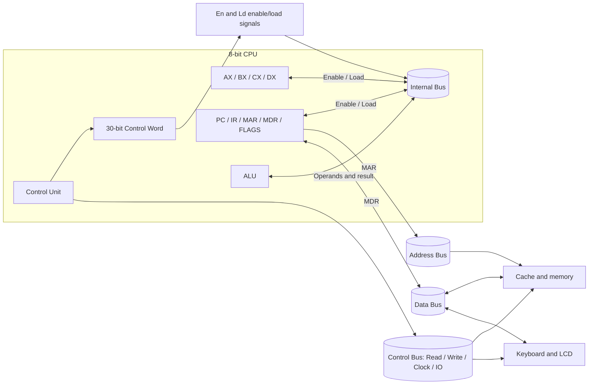

## 03. Tri-State Arbitration and Control Word

**Criterion:** G1  
**Note:** The controller prevents contention between transmitters. HIGH_Z is the state of every unselected transmitter.

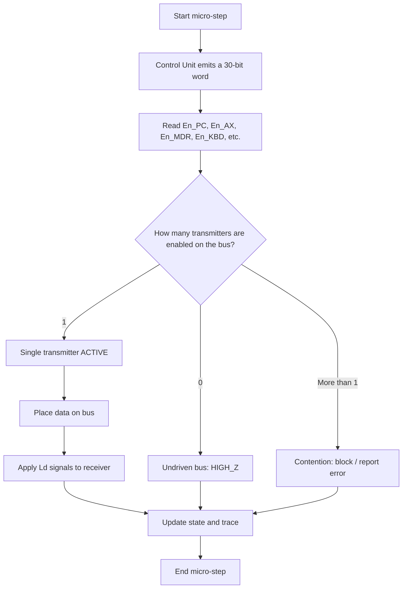

## 04. Instruction Cycle and Micro-Operations

**Criteria:** G1, G5  
**Note:** Functional sequence FETCH → DECODE → EXECUTE → STORE; a cache miss or page fault may introduce additional micro-steps.

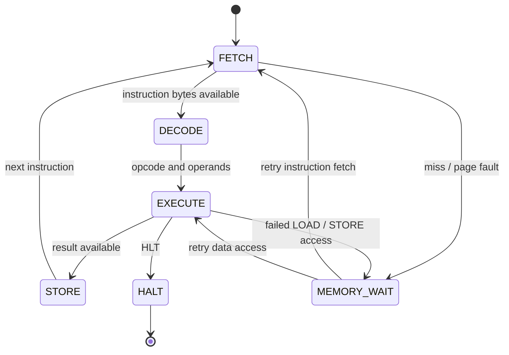

## 05. L1I / L1D / L2 Cache Hierarchy

**Criterion:** G2  
**Note:** Conceptual cache read and update path. L1I and L1D each hold one 8 B line; L2 holds four 8 B lines and uses FIFO replacement.

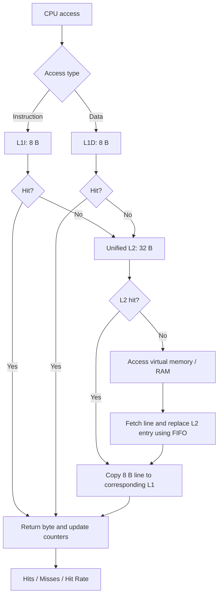

## 06. Virtual Address Translation

**Criterion:** G3  
**Note:** 16 virtual pages of 32 B (512 B); 8 physical frames of 32 B (256 B). VPN = virtual address div 32; offset = virtual address mod 32.

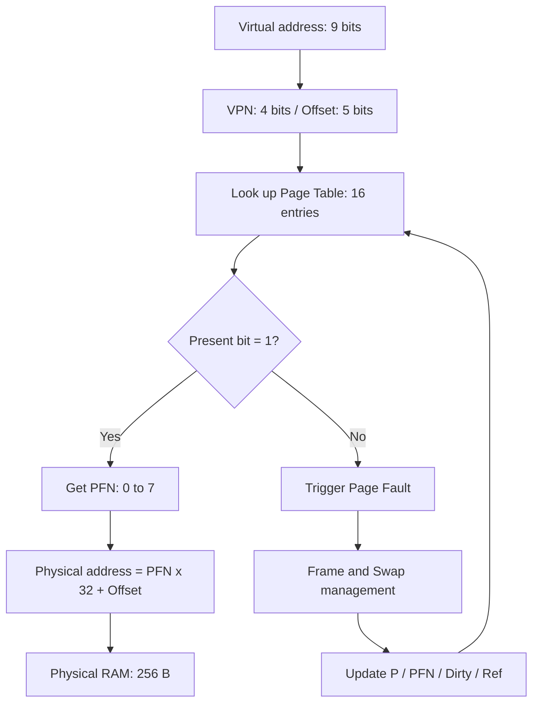

## 07. Page Fault Handling with FIFO Replacement

**Criterion:** G3  
**Note:** The project's documentation states that frame 7 is pinned for MMIO; it must not be selected as a FIFO victim.

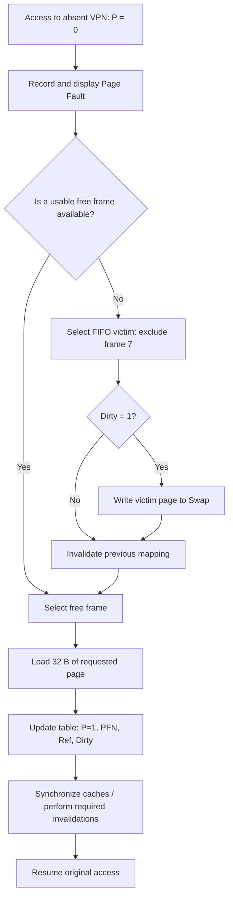

## 08. Input/Output: Keyboard and LCD

**Criterion:** G4  
**Note:** The keyboard has an 8-byte FIFO and virtual MMIO range 1F8h–1FFh; its physical storage is E8h–EFh. The LCD uses F8h–FFh and a circular cursor.

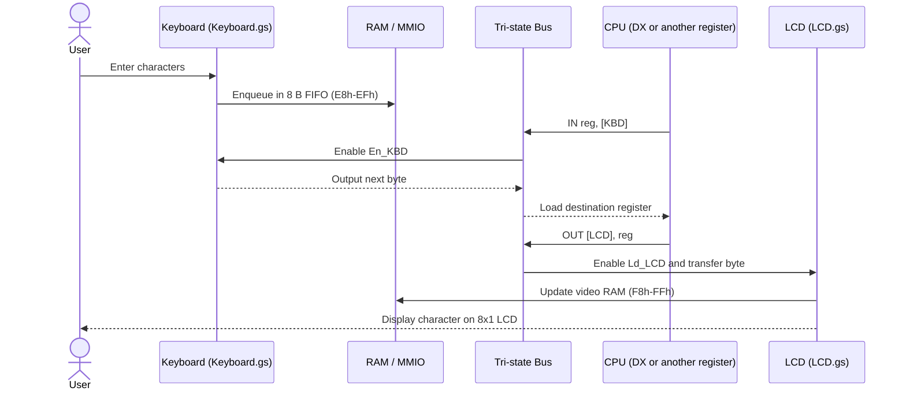

## 09. Program Editor, Assembler, and Loader

**Criterion:** G5  
**Note:** Reflects the documented persistent catalog containing four demonstration programs and a two-pass assembler.

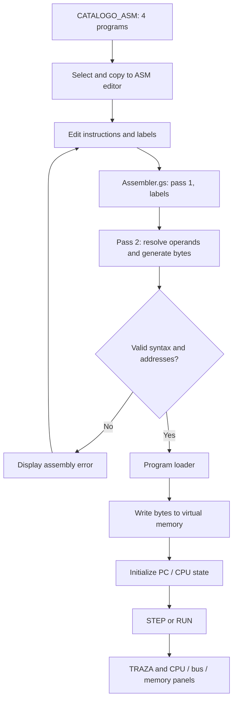

## 10. Source Code Module Organization

**Criterion:** G6  
**Note:** Map of source files visible in the repository's main branch; arrows show conceptual dependencies, not an exact function-call graph.

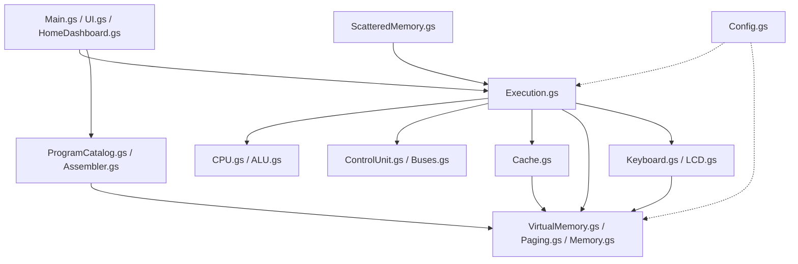

## 11. Demonstration Procedure for the Oral Defense

**Criteria:** G2–G5  
**Note:** Suggested walkthrough to demonstrate catalog programs, CPU states, I/O transfers, and memory faults.

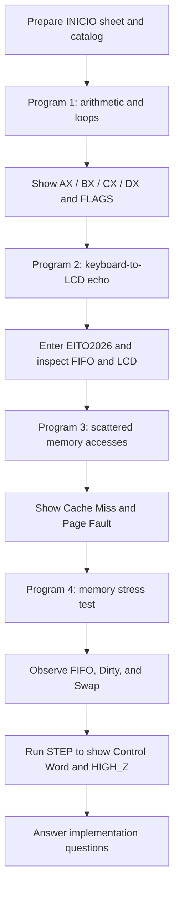

## Submission Notes

- Verify the actual execution of all four programs and dynamic signal changes in Google Sheets.
- Confirm FIFO, write-through, and write-allocate policies against the deployed version.
- Keep physical and virtual MMIO mappings consistent with the current code.
- Include the diagrams in README.md and README_EN.md with bilingual explanations.
