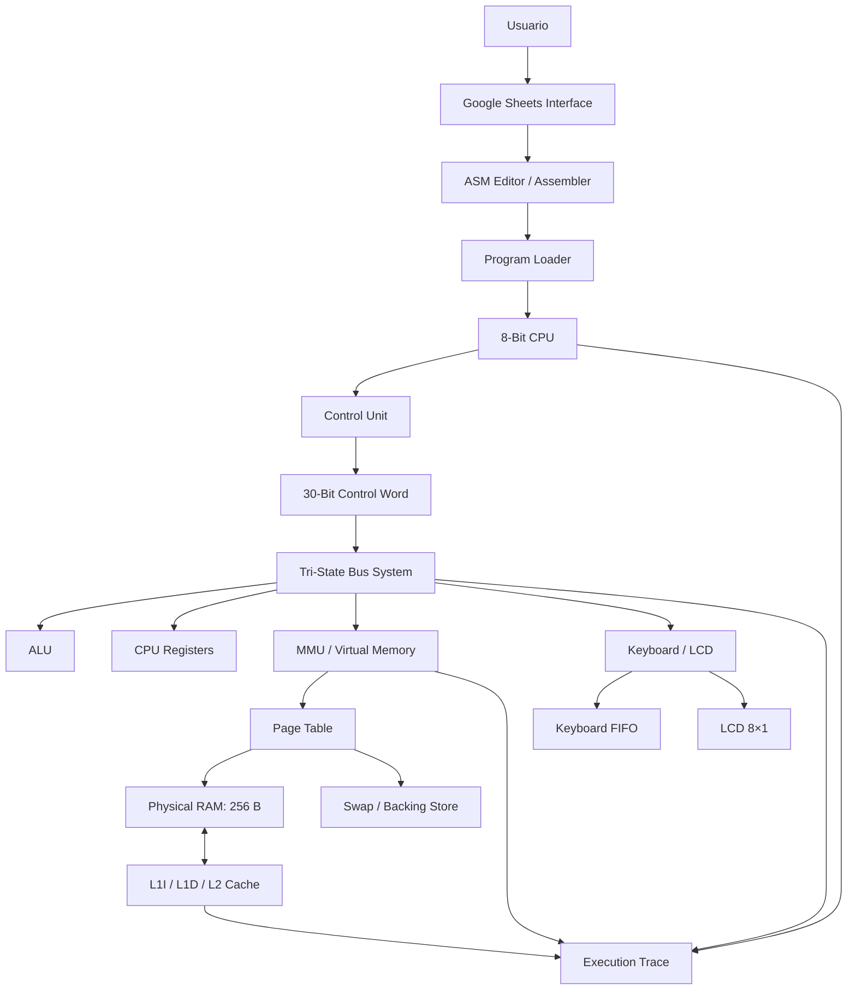
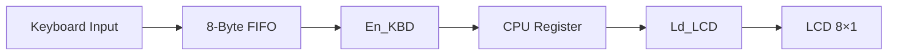

# EitoDiceBanana CPU Simulator

### 8-Bit Computer Architecture Simulator | UCB — SIS-131


**EitoDiceBanana CPU Simulator** is an educational 8-bit computer architecture simulator developed using Google Sheets and Google Apps Script for the Computer Architecture course at Universidad Católica Boliviana (UCB), SIS-131.

The project emulates the internal operation of a simplified computer system, including CPU registers, an ALU, control unit, micro-operations, tri-state buses, multilevel cache, virtual memory, paging, swap, assembly language, and keyboard/LCD peripherals.

Its purpose is to make computer architecture concepts observable and interactive through a spreadsheet-based environment.

---

# 🇪🇸 Documentación en español

## 1. Descripción general

EitoDiceBanana es un simulador educativo de arquitectura de computadores de 8 bits. Permite observar cómo se ejecutan las instrucciones de un programa desde la búsqueda de instrucciones (*Fetch*) hasta su ejecución y almacenamiento del resultado (*Store*).

El simulador integra:

- CPU de 8 bits con cuatro registros de propósito general.
- ALU para operaciones aritméticas y lógicas.
- Unidad de control basada en palabras de control y microoperaciones.
- Buses internos y externos con buffers Tri-State.
- Jerarquía de caché L1I, L1D y L2.
- Memoria virtual de 512 bytes.
- RAM física de 256 bytes.
- Paginación con reemplazo FIFO y almacenamiento Swap.
- Ensamblador de dos pasadas y editor de programas ASM.
- Catálogo de programas de demostración.
- Teclado FIFO de 8 bytes.
- Pantalla LCD de 8×1 caracteres.
- Dashboard centralizado para supervisar el estado del simulador.

## 2. Arquitectura del sistema

### 2.1. Diagrama general



### 2.2. Ciclo de instrucción

La CPU utiliza cuatro fases principales:

| Fase | Descripción |
|---|---|
| FETCH | Obtiene los bytes de la instrucción desde memoria. |
| DECODE | Identifica el opcode y los operandos. |
| EXECUTE | Ejecuta la operación mediante la ALU, registros o memoria. |
| STORE | Almacena el resultado y actualiza los registros o flags correspondientes. |

Cada fase puede dividirse en microoperaciones controladas por la unidad de control.

### 2.3. Registros de la CPU

| Registro | Tamaño | Función |
|---|---:|---|
| AX | 8 bits | Registro de propósito general. |
| BX | 8 bits | Registro de propósito general. |
| CX | 8 bits | Registro de propósito general. |
| DX | 8 bits | Registro de propósito general. |
| PC | 8 bits | Program Counter. |
| IR | 8 bits | Instruction Register. |
| MAR | 8 bits | Memory Address Register. |
| MDR | 8 bits | Memory Data Register. |
| ZF | 1 bit | Zero Flag. |
| CF | 1 bit | Carry Flag. |
| SF | 1 bit | Sign Flag. |

Los cuatro registros generales son AX, BX, CX y DX. Los registros de control y estado permiten visualizar el proceso de ejecución.

### 2.4. Unidad de control y palabra de control

La unidad de control genera una palabra de control de **30 bits**, compuesta por:

- 26 señales binarias de control.
- 4 bits para seleccionar la operación de la ALU (`ALU_OP`).

Formato:

```text
| 26 CONTROL SIGNALS | 4 ALU_OP BITS |
|--------------------|---------------|
|       26 bits      |     4 bits    |
|       TOTAL: 30 BITS              |
```

Las 26 señales son:

| Grupo | Señales |
|---|---|
| PC | `En_PC`, `Ld_PC`, `Inc_PC` |
| MAR | `En_MAR`, `Ld_MAR` |
| Memoria | `Mem_R`, `Mem_W`, `Ld_MDR`, `En_MDR` |
| IR | `En_IR`, `Ld_IR` |
| AX | `En_AX`, `Ld_AX` |
| BX | `En_BX`, `Ld_BX` |
| CX | `En_CX`, `Ld_CX` |
| DX | `En_DX`, `Ld_DX` |
| ALU | `En_ALU`, `Ld_ALU_A`, `Ld_ALU_B`, `Ld_FLAGS` |
| E/S | `En_KBD`, `Ld_LCD` |
| Inmediatos | `En_IMM` |

Operaciones codificadas en `ALU_OP`:

| Código | Operación |
|---|---|
| 0000 | NONE |
| 0001 | ADD |
| 0010 | SUB |
| 0011 | INC |
| 0100 | DEC |
| 0101 | CMP |
| 0110 | AND |
| 0111 | OR |
| 1000 | XOR |
| 1001 | NOT |

La unidad de control valida las señales y evita conflictos entre transmisores del bus interno. Los buffers Tri-State permiten que un transmisor conduzca el bus mientras los demás permanecen en estado `HIGH_Z`.

### 2.5. Sistema de buses

El simulador representa tres buses principales:

| Bus | Función |
|---|---|
| Internal Bus | Transferencia de datos entre registros, ALU y componentes internos. |
| Address Bus | Transporte de direcciones desde MAR. |
| Data Bus | Transferencia bidireccional entre memoria y MDR. |

El panel `BUSES` permite observar:

- Estado del bus.
- Transmisor activo.
- Valor hexadecimal y binario.
- Dirección y sentido de transferencia.
- Señales de control.
- Estado de los buffers Tri-State (`ACTIVE` / `HIGH_Z`).

### 2.6. Jerarquía de caché

La arquitectura utiliza tres niveles:

| Nivel | Capacidad | Organización |
|---|---:|---|
| L1I | 8 bytes | Caché de instrucciones, una línea. |
| L1D | 8 bytes | Caché de datos, una línea. |
| L2 | 32 bytes | Caché unificada, cuatro líneas. |

Configuración:

- Tamaño de línea: 8 bytes.
- Reemplazo L1: una línea por nivel.
- Reemplazo L2: FIFO.
- Política de escritura: Write-through.
- Asignación en escritura: Write-allocate.

El módulo registra accesos, hits, misses, reemplazos, invalidaciones y estadísticas de rendimiento.

### 2.7. Memoria virtual y paginación

El simulador implementa una memoria virtual de 512 bytes y una memoria física de 256 bytes.

| Característica | Valor |
|---|---:|
| Espacio virtual | 512 bytes |
| Espacio físico | 256 bytes |
| Tamaño de página | 32 bytes |
| Número de páginas virtuales | 16 |
| Número de marcos físicos | 8 |
| Política de reemplazo | FIFO |
| Almacenamiento secundario | Swap emulado |

La dirección virtual de 9 bits se divide en:

```text
| VPN: 4 bits | OFFSET: 5 bits |
|-------------|----------------|
| Página      | Desplazamiento |
```

La MMU traduce las direcciones virtuales mediante la tabla de páginas.

Cuando una página no está presente en RAM se produce un **Page Fault**. El sistema busca un marco libre o selecciona una página víctima mediante FIFO.

Si la página víctima fue modificada, su contenido se conserva en el almacenamiento Swap antes del reemplazo. La página solicitada se carga en RAM y se actualiza la tabla de páginas.

**Frame 7 está reservado y fijado para los periféricos**, por lo que no participa en el reemplazo FIFO.

#### Distribución de memoria de periféricos

| Dirección física | Uso |
|---|---|
| E0h–E7h | Reservado |
| E8h–EFh | FIFO del teclado |
| F0h–F7h | Reservado |
| F8h–FFh | Buffer de video LCD |

El teclado utiliza el espacio MMIO virtual `1F8h–1FFh`, asociado a su almacenamiento físico `E8h–EFh`.

El buffer del LCD utiliza las direcciones físicas `F8h–FFh`.

Las regiones reservadas están protegidas frente a escrituras normales de memoria virtual.

### 2.8. Periféricos de entrada y salida

**Teclado**

- Cola FIFO de 8 bytes.
- Entrada de caracteres desde la interfaz de Google Sheets.
- Almacenamiento real de los bytes en RAM física `E8h–EFh`.
- Interfaz virtual MMIO `1F8h–1FFh`.
- Lectura mediante la señal `En_KBD`.
- Conservación del orden de entrada.

**LCD**

- Pantalla emulada de 8×1 caracteres.
- Buffer físico `F8h–FFh`.
- Un byte por posición.
- Cursor circular.
- Escritura controlada mediante `Ld_LCD`.

El flujo de demostración es:



## 3. Instruction Set Architecture (ISA)

La CPU utiliza instrucciones de longitud variable, con operandos codificados según el tipo de instrucción.

### 3.1. Transferencia de datos y E/S

| Instrucción | Opcode | Bytes | Descripción |
|---|---:|---:|---|
| MOV_IMM | 01h | 4 | Carga un valor inmediato en un registro. |
| MOV_REG | 02h | 3 | Copia el valor de un registro a otro. |
| LOAD | 03h | 4 | Lee desde memoria virtual hacia un registro. |
| STORE | 04h | 4 | Escribe un registro en memoria virtual. |
| IN | 05h | 2 | Lee un byte desde el teclado. |
| OUT | 06h | 2 | Envía un byte al LCD. |

### 3.2. Operaciones aritméticas

| Instrucción | Opcode | Bytes | Descripción |
|---|---:|---:|---|
| ADD | 10h | 4 | Suma dos operandos. |
| SUB | 11h | 4 | Resta dos operandos. |
| INC | 12h | 2 | Incrementa un registro. |
| DEC | 13h | 2 | Decrementa un registro. |
| CMP | 14h | 4 | Compara dos operandos y actualiza flags. |

### 3.3. Operaciones lógicas

| Instrucción | Opcode | Bytes | Descripción |
|---|---:|---:|---|
| AND | 15h | 4 | AND bit a bit. |
| OR | 16h | 4 | OR bit a bit. |
| XOR | 17h | 4 | XOR bit a bit. |
| NOT | 18h | 2 | NOT bit a bit. |

### 3.4. Control de flujo

| Instrucción | Opcode | Bytes | Descripción |
|---|---:|---:|---|
| JMP | 20h | 2 | Salto incondicional. |
| JZ | 21h | 2 | Salta si ZF = 1. |
| JNZ | 22h | 2 | Salta si ZF = 0. |
| HLT | FFh | 1 | Detiene la ejecución. |

### 3.5. Ejemplo de programa ASM

```asm
; Arithmetic example

MOV AX, 05h
MOV BX, 03h
ADD AX, BX
STORE [100h], AX
LOAD CX, [100h]
HLT
```

El ensamblador admite etiquetas simbólicas para construir ciclos y saltos condicionales.

## 4. Catálogo de programas de demostración

El simulador incluye un catálogo persistente de programas en la hoja `CATALOGO_ASM`.

Los programas pueden seleccionarse y copiarse al editor `ASM`, donde se pueden modificar sin alterar el original del catálogo.

| Programa | Objetivo |
|---|---|
| Program 1 — Arithmetic and Loops | Utiliza AX, BX, CX y DX para realizar operaciones aritméticas y un ciclo. |
| Program 2 — Keyboard to LCD Echo | Lee ocho caracteres desde el teclado y los muestra en el LCD. |
| Program 3 — Scattered Memory Access | Accede a páginas virtuales no consecutivas y demuestra fallos de página y misses de caché. |
| Program 4 — Scattered Memory Stress Test | Amplía los accesos dispersos y permite observar reemplazos FIFO y transferencias Swap. |

### Demostración 1: Arithmetic and Loops

Ejecuta operaciones aritméticas con los cuatro registros generales y utiliza saltos condicionales para repetir instrucciones.

### Demostración 2: Keyboard to LCD Echo

Permite ingresar ocho caracteres y observar cómo pasan por la FIFO del teclado, los registros de la CPU y el LCD.

Para la demostración preparada en el catálogo, se utiliza la entrada:

```text
EITO2026
```

### Demostración 3: Scattered Memory Access

Accede a direcciones de páginas virtuales no consecutivas. Permite observar:

- Traducción de direcciones.
- Page Faults.
- Carga de páginas.
- Reemplazo FIFO.
- Accesos a Swap.
- Cache Hits y Cache Misses.

### Demostración 4: Scattered Memory Stress Test

Accede a ocho páginas virtuales no consecutivas, realiza escrituras y lecturas y permite demostrar reemplazos de páginas, preservación de datos modificados y actividad de caché.

## 5. Interfaz y dashboard

La hoja `INICIO` incorpora un dashboard centralizado que permite visualizar:

- Controles de ejecución.
- Fases del ciclo de instrucción.
- Registros de la CPU y flags.
- Estado de los buses.
- Palabra de control.
- Métricas de caché.
- Memoria física y virtual.
- Estado de la tabla de páginas.
- Entrada del teclado y salida del LCD.
- Navegación entre módulos.

### Hojas del simulador

| Hoja | Función |
|---|---|
| INICIO | Dashboard principal. |
| CPU | Registros, flags y estado del procesador. |
| BUSES | Buses y buffers Tri-State. |
| MEMORIA | RAM física. |
| PAGINAS | Tabla de páginas, MMU y Swap. |
| CACHE | Jerarquía L1/L2 y métricas. |
| E-S | Teclado y LCD. |
| ASM | Editor y ensamblador. |
| TRAZA | Registro de microoperaciones y ejecución. |
| EQUIPO | Información del equipo. |
| CATALOGO_ASM | Catálogo persistente de programas. |

## 6. Manual de instalación y uso

### Requisitos

- Cuenta de Google.
- Google Sheets.
- Acceso al proyecto de Apps Script vinculado a la hoja.
- Navegador web actualizado.

### Instalación

1. Abre la hoja de cálculo del simulador.
2. Abre **Extensiones → Apps Script**.
3. Incorpora los archivos `.gs` del repositorio al proyecto vinculado.
4. Guarda los cambios.
5. Ejecuta `setupSimulator()` únicamente durante la instalación inicial.
6. Ejecuta `setupProgramCatalog()` para preparar el catálogo de programas.
7. Ejecuta `setupTask18Home()` para construir el dashboard principal.
8. Autoriza los permisos solicitados por Google Apps Script.
9. Recarga la hoja de cálculo.

> **Advertencia:** `setupSimulator()` reconstruye las hojas y elimina su contenido anterior. No debe ejecutarse nuevamente sobre un simulador que ya tenga datos de trabajo. `setupTask18Home()` modifica la hoja `INICIO`, mientras que `setupProgramCatalog()` prepara la hoja del catálogo.

### Ejecutar un programa

1. Abre `CATALOGO_ASM`.
2. Selecciona uno de los programas disponibles.
3. Abre `ASM` y revisa el código copiado.
4. Modifica el código si es necesario.
5. Ensambla el programa desde la interfaz.
6. Carga el programa en la memoria.
7. Utiliza `STEP` para ejecutar una microoperación a la vez o `RUN` para ejecutar continuamente.
8. Utiliza `PAUSE`, `RESUME` y `RESET` cuando corresponda.
9. Consulta `CPU`, `BUSES`, `MEMORIA`, `PAGINAS`, `CACHE`, `E-S` y `TRAZA` para observar los resultados.

### Controles de ejecución

| Control | Acción |
|---|---|
| STEP | Ejecuta un micro-paso. |
| RUN | Ejecuta continuamente. |
| PAUSE | Solicita detener temporalmente la ejecución. |
| RESUME | Reanuda la ejecución pausada. |
| RESET | Reinicia el estado de ejecución. |
| LOAD PROGRAM | Ensambla y carga el programa seleccionado. |

## 7. Pruebas y validación

El proyecto incluye funciones de prueba dentro de sus módulos. Entre ellas:

| Módulo | Función de prueba |
|---|---|
| CPU | `testCPUModule()` |
| Buses | `testBusesModule()` |
| Unidad de control | `testControlWordModule()` |
| Conflictos de bus | `testControlBusContention()` |
| Memoria virtual | `testVirtualMemoryModule()` |
| Paginación | `testTask08PagingModule()` |
| Caché | `testCacheModule()` |
| Ensamblador | `testExtendedAssemblerModule()` |
| Ejecución | `testExecutionModule()` |
| Teclado | `testKeyboardModule()` |
| Integración teclado-CPU | `testTask11KeyboardCPUIntegration()` |
| Protección del LCD | `testTask12LCDFrameProtection()` |
| Catálogo ASM | `testTask14CatalogModule()` |
| Programas del catálogo | `testTask14ProgramsExecution()` |
| Eco teclado-LCD | `testTask16KeyboardLCDEcho()` |
| Accesos dispersos | `testTask17ScatteredMemoryProgram()` |

Las pruebas deben ejecutarse en el entorno de Google Sheets y Apps Script. La existencia de una función de prueba no implica por sí sola que haya sido ejecutada satisfactoriamente en todas las versiones del proyecto.

## 8. Correspondencia con la rúbrica SIS-131

| Criterio | Área del proyecto | Evidencia principal |
|---|---|---|
| G1 | Buses y Tri-State | Panel BUSES, estados HIGH_Z/ACTIVE y control de transmisores. |
| G2 | Caché multinivel | L1I, L1D, L2, estadísticas de hit/miss y reemplazos. |
| G3 | Memoria virtual | MMU, Page Table, Page Fault, FIFO y Swap. |
| G4 | Entrada/Salida | Teclado FIFO de 8 bytes y LCD de 8×1. |
| G5 | Ensamblador y programas | ISA, editor ASM, catálogo y programas de demostración. |
| G6 | Documentación | README bilingüe, diagramas, ISA, manual y palabra de control. |
| G7 | Identidad e interfaz | Dashboard, diseño visual y hojas organizadas. |

### Evaluación individual y organización

La evaluación del proyecto también contempla aspectos de trabajo en equipo y participación individual:

- Organización de tareas mediante Kanban.
- Uso de Git y estrategia Gitflow.
- Ramas de funcionalidades.
- Commits y Pull Requests.
- Integración de cambios en `develop` y `main`.
- Presentación grupal del proyecto.
- Defensa técnica individual.

El código fuente y el historial de desarrollo se encuentran disponibles en GitHub.

## 9. Tecnologías utilizadas

- Google Sheets.
- Google Apps Script.
- JavaScript.
- Git.
- GitHub.
- Mermaid para diagramas de arquitectura.

## 10. Estructura del repositorio

Los módulos principales del simulador están organizados en archivos independientes:

| Archivo | Responsabilidad |
|---|---|
| `Config.gs` | Configuración global. |
| `UI.gs` | Estructura inicial de las hojas. |
| `HomeDashboard.gs` | Dashboard principal. |
| `CPU.gs` | Registros y flags. |
| `ALU.gs` | Operaciones aritméticas y lógicas. |
| `ControlUnit.gs` | Palabra de control y microoperaciones. |
| `Buses.gs` | Buses y buffers Tri-State. |
| `Memory.gs` | RAM física. |
| `VirtualMemory.gs` | MMU y traducción de direcciones. |
| `Paging.gs` | Page Fault, FIFO y Swap. |
| `Cache.gs` | Jerarquía de caché. |
| `Keyboard.gs` | Periférico de entrada. |
| `LCD.gs` | Periférico de salida. |
| `Assembler.gs` | Ensamblador y carga de programas. |
| `Execution.gs` | Motor de ejecución. |
| `ProgramCatalog.gs` | Catálogo de programas ASM. |
| `Main.gs` | Control general y comandos de ejecución. |

---

# 🇬🇧 English Documentation

## 1. Project Overview

EitoDiceBanana is an educational 8-bit computer architecture simulator developed with Google Sheets and Google Apps Script for the UCB SIS-131 Computer Architecture course.

The simulator demonstrates how a simplified computer executes assembly instructions through its CPU, ALU, control unit, buses, memory hierarchy, and I/O peripherals.

It provides a visual environment to inspect instruction execution, register transfers, control signals, memory translations, cache activity, page faults, and peripheral communication.

## 2. System Architecture

### Main components

- **8-bit CPU:** Four general-purpose registers AX, BX, CX, DX, and control registers PC, IR, MAR, MDR.
- **ALU:** Arithmetic and logical operations.
- **Control Unit:** Generates 30-bit control words and coordinates micro-operations.
- **Tri-State Buses:** Internal, address, and data bus visualization.
- **Cache:** L1I, L1D, and unified L2 cache.
- **Virtual Memory:** 512-byte virtual address space.
- **Physical RAM:** 256 bytes organized into eight frames.
- **Paging:** Sixteen virtual pages, 32 bytes per page, FIFO replacement, and emulated Swap.
- **Keyboard:** 8-byte FIFO input peripheral.
- **LCD:** 8×1 character output peripheral.
- **Assembler:** Two-pass assembly parser, symbolic labels, and program loader.
- **Program Catalog:** Persistent assembly program storage and selection.
- **Home Dashboard:** Centralized system monitoring and execution controls.

### Instruction cycle

The CPU follows four main phases:

1. **FETCH:** Retrieve the instruction from memory.
2. **DECODE:** Identify the opcode and operands.
3. **EXECUTE:** Perform the operation using the ALU, registers, or memory.
4. **STORE:** Save the result and update the relevant flags.

### Control Word

The control unit generates a 30-bit word:

- 26 binary control signals.
- 4 bits for `ALU_OP`.

The signals coordinate register enables and loads, memory reads and writes, ALU operations, keyboard input, and LCD output.

The control unit validates signal combinations and prevents multiple transmitters from driving the shared internal bus simultaneously.

### Cache hierarchy

| Level | Capacity | Organization |
|---|---:|---|
| L1I | 8 bytes | One instruction-cache line. |
| L1D | 8 bytes | One data-cache line. |
| L2 | 32 bytes | Four unified-cache lines. |

Cache line size is 8 bytes. L2 uses FIFO replacement and the write policy is write-through with write-allocate.

### Virtual memory

| Property | Value |
|---|---:|
| Virtual memory | 512 bytes |
| Physical RAM | 256 bytes |
| Page size | 32 bytes |
| Virtual pages | 16 |
| Physical frames | 8 |
| Replacement policy | FIFO |
| Secondary storage | Emulated Swap |

Virtual addresses contain a 4-bit VPN and a 5-bit offset.

When a requested page is not resident, the MMU triggers a Page Fault. The paging subsystem loads the requested page into a free frame or selects a FIFO victim. Modified victim pages are preserved in Swap before replacement.

Physical Frame 7 is pinned for I/O and excluded from FIFO replacement.

### I/O memory mapping

| Physical address | Purpose |
|---|---|
| E0h–E7h | Reserved |
| E8h–EFh | Keyboard FIFO |
| F0h–F7h | Reserved |
| F8h–FFh | LCD video buffer |

The keyboard is accessed through virtual MMIO addresses `1F8h–1FFh`, mapped to its physical FIFO storage at `E8h–EFh`.

The LCD uses the physical buffer at `F8h–FFh`.

Normal virtual-memory writes are prevented from overwriting these reserved peripheral regions.

## 3. Instruction Set Architecture

The processor supports the following instructions:

| Category | Instructions |
|---|---|
| Data transfer | MOV_IMM, MOV_REG, LOAD, STORE |
| Input/Output | IN, OUT |
| Arithmetic | ADD, SUB, INC, DEC, CMP |
| Logical | AND, OR, XOR, NOT |
| Control flow | JMP, JZ, JNZ, HLT |

The assembler supports symbolic labels and variable-length instructions.

Example:

```asm
MOV AX, 05h
MOV BX, 03h
ADD AX, BX
STORE [100h], AX
LOAD CX, [100h]
HLT
```

## 4. Demonstration Programs

The persistent ASM catalog includes:

1. **Arithmetic and Loops:** Uses AX, BX, CX, and DX in arithmetic operations and conditional loops.
2. **Keyboard to LCD Echo:** Reads eight characters from the keyboard FIFO and displays them on the LCD.
3. **Scattered Memory Access:** Accesses nonconsecutive virtual pages to demonstrate Page Faults and Cache Misses.
4. **Scattered Memory Stress Test:** Extends scattered accesses to demonstrate FIFO replacement and Swap transfers.

Programs are selected from `CATALOGO_ASM` and copied into the `ASM` editor. Editing the working copy does not modify the original catalog entry.

## 5. User Interface

The `INICIO` dashboard provides a centralized view of:

- CPU registers and flags.
- Instruction execution cycle.
- Active bus states.
- Control word and active signals.
- Cache hit/miss metrics.
- Virtual and physical memory status.
- Page table and Swap activity.
- Keyboard input and LCD output.
- Navigation to simulator modules.

The simulator also provides dedicated sheets for CPU, buses, memory, paging, cache, I/O, ASM, execution trace, team information, and the program catalog.

## 6. Installation and Usage

### Requirements

- Google account.
- Google Sheets.
- Access to the bound Google Apps Script project.
- Modern web browser.

### Installation steps

1. Open the simulator spreadsheet.
2. Select **Extensions → Apps Script**.
3. Add the `.gs` files from the repository to the bound script project.
4. Save the project.
5. Run `setupSimulator()` only for the initial installation.
6. Run `setupProgramCatalog()` to initialize the program catalog.
7. Run `setupTask18Home()` to build the main dashboard.
8. Grant the requested Google Apps Script permissions.
9. Reload the spreadsheet.

> **Warning:** `setupSimulator()` rebuilds the simulator sheets and clears their previous contents. Do not run it again on an existing working simulator. `setupTask18Home()` modifies only `INICIO`, while `setupProgramCatalog()` prepares the catalog sheet.

### Running a program

1. Open `CATALOGO_ASM`.
2. Select a demonstration program.
3. Review the copied source code in `ASM`.
4. Edit the source if necessary.
5. Assemble the program.
6. Load the program into memory.
7. Use `STEP` to execute one micro-operation at a time or `RUN` for continuous execution.
8. Use `PAUSE`, `RESUME`, and `RESET` when needed.
9. Inspect the CPU, buses, memory, paging, cache, I/O, and trace sheets.

## 7. Testing

The source code includes module-level test functions for CPU, buses, control unit, memory, paging, cache, assembler, execution, keyboard, LCD, and program catalog integration.

Tests should be executed in the Google Sheets and Apps Script environment. A test function being present in the repository does not by itself establish that it passed in every project version.

## 8. SIS-131 Rubric Coverage

| Rubric criterion | Project implementation |
|---|---|
| G1 — Buses / Tri-State | Bus monitoring and transmitter control. |
| G2 — Cache | L1I, L1D, L2, hit/miss metrics. |
| G3 — Virtual Memory | MMU, paging, FIFO, Page Faults, Swap. |
| G4 — I/O | Keyboard FIFO and 8×1 LCD. |
| G5 — Assembly | ISA, assembler, program catalog, demonstrations. |
| G6 — Documentation | Bilingual README, diagrams, ISA, manual, control word. |
| G7 — Interface | Home Dashboard and organized simulator sheets. |

The course evaluation also considers Kanban organization, Gitflow, commits, Pull Requests, group presentation, and individual technical defense.

## 9. Technologies

- Google Sheets
- Google Apps Script
- JavaScript
- Git
- GitHub
- Mermaid

## 10. Repository Structure

The simulator is organized into independent `.gs` modules for configuration, interface, dashboard, CPU, ALU, control unit, buses, memory, virtual memory, paging, cache, keyboard, LCD, assembler, execution, program catalog, and main controller.

---

# Project Information

**Project:** EitoDiceBanana CPU Simulator  
**Course:** Computer Architecture — SIS-131  
**University:** Universidad Católica Boliviana (UCB)  
**Version:** 2.0.0

### Team

- Ana Cabrera
- Eito Ygei
- Eduardo Miranda

### Project Resources

- **GitHub Repository:** https://github.com/anaaacg/eitodicebanana_cpu_simulator_EC2
- **Google Sheets Simulator:** https://docs.google.com/spreadsheets/d/1Q1Z3-gEOLg5WiQmmOn5n4sjX1HhEtP-ETrtq5bWOZEY/edit
- **GitHub Project Board:** https://github.com/users/anaaacg/projects/3

---

*EitoDiceBanana — Understanding computer architecture through simulation.*
